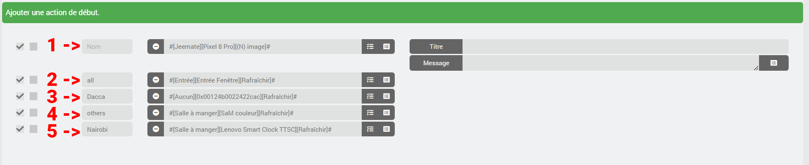
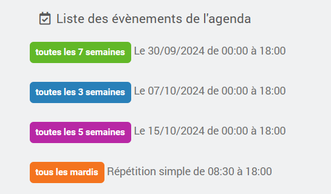
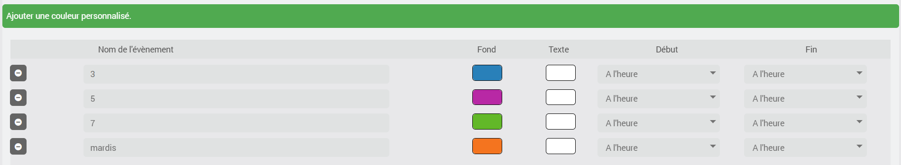
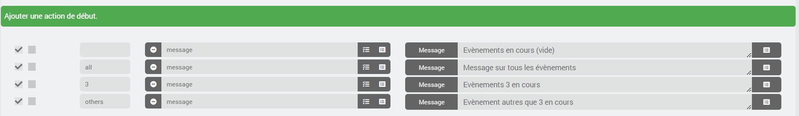
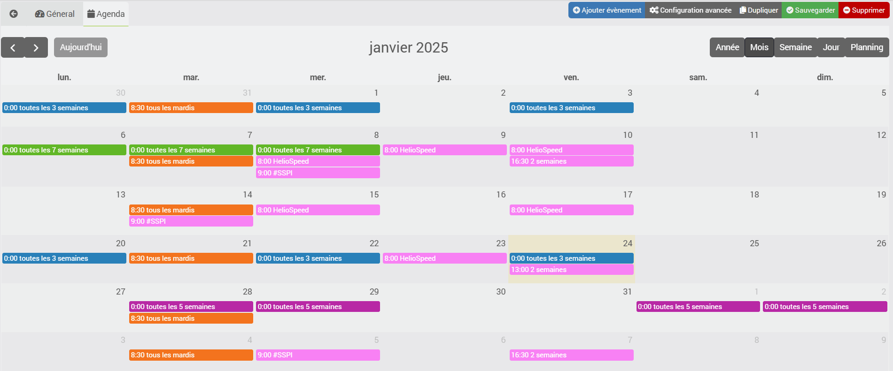

# Plugin „import2calendar“

Das Plugin dient dazu, einen Kalender im iCal-Format in das offizielle Jeedom-Kalender-Plugin (calendar) zu importieren. Dieses muss daher installiert und konfiguriert sein.
## Voraussetzungen
### Stabil
- Mindestens Jeedom 4.4, mindestens Debian 11
- Plugin „Agenda“, installiert und aktiviert
- Plugin „import2calendar“

### Beta
- Mindestens Jeedom 4.6, mindestens Debian 12
- Plugin „Agenda“, installiert und aktiviert
- Plugin „import2calendar“

## Achtung
**Es sind keine Änderungen am iCal möglich. Die Daten werden aus dem iCal abgerufen und an das Jeedom-Plugin „Agenda“ gesendet. Nehmen Sie keine Änderungen am im Plugin „Agenda“ erstellten Kalender vor, da diese beim nächsten Update Ihres iCal gelöscht würden.**

# <u>Konfiguration</u>

## Einrichtung des Plugins
- **Anzahl der Tage, die ein Ereignis gespeichert bleibt**: Zeitraum, in dem ein vergangenes Ereignis im Kalender verbleibt, von 3 bis 31 Tagen (Standardwert: 3).
- **Aufträge der kommenden Tage**: Fügt die Aufträge der kommenden Tage (siehe Abschnitt „Agenda-Plugin“) zu allen Kalendern des Agenda-Plugins hinzu, einschließlich derjenigen, die nicht von import2calendar erstellt wurden.

## Gerät anlegen
Fügen Sie zunächst ein Gerät hinzu und wählen Sie einen Namen dafür aus
### Importparameter
- **ical**: Geben Sie die URL der zu konvertierenden iCal-Datei an.
- **Benutzername** und **Passwort**: Nur ausfüllen, wenn der Kalender-Server eine Authentifizierung verlangt (z. B. Baïkal mit einer URL der Form `http://serveur/dav.php/calendars/utilisateur/default?export`). Bei Google, Outlook und öffentlichen Adressen leer lassen.
  - Geben Sie das Passwort nicht in die URL ein: In diesen Feldern wird es verschlüsselt und nie wieder angezeigt.
  - Lassen Sie das Feld **Passwort** leer, um das gespeicherte Passwort beizubehalten. Löschen Sie den Eintrag im Feld **Benutzername**, um ihn zu entfernen.
  - Es werden die Authentifizierungsmethoden „Digest“ und – ausschließlich bei HTTPS – „Basic“ akzeptiert. Das Zertifikat einer HTTPS-Adresse muss gültig sein.
  - Geben Sie die endgültige Adresse des Kalenders an: Weiterleitungen werden nicht verfolgt, wenn eine Kennung angegeben ist.
- **Vorgeschriebene Startzeiten**: Wählen Sie eine Startzeit für alle Ereignisse im Kalender aus. Standardmäßig werden die im iCal gespeicherten Startzeiten der Ereignisse verwendet.
- **Vorgeschriebene Endzeiten**: Wählen Sie eine Endzeit für alle Ereignisse im Kalender aus. Standardmäßig werden die im iCal gespeicherten Endzeiten der Ereignisse verwendet.
- **Allgemeiner iCal**: Französische Schulferien und Feiertage. Wenn diese Option ausgewählt ist, geben Sie im iCal-Feld nichts ein.
- **Automatische Aktualisierung**: Wählen Sie den gewünschten Cron-Job für die Aktualisierung des Kalenders aus.

### Anzeigeeinstellungen
- **Symbol**: Das Symbol, das jedem Ereignis zugewiesen wird.
- **Hintergrundfarbe**: Standard-Hintergrundfarbe für jedes Ereignis.
- **Textfarbe**: Standard-Textfarbe für jedes Ereignis.

### Anpassung von Ereignissen
Hier können Sie bestimmte Ereignisse in Ihrem iCal individuell anpassen.

- Hintergrundfarbe und Textfarbe.

Hier sind standardmäßig keine Änderungen vorgenommen worden. Mit diesen Optionen können Sie die Start- und Endzeit ändern, um beispielsweise geplante Aktionen vorwegzunehmen.
- Start: Die Veranstaltung beginnt X Minuten vor der angegebenen Startzeit (von 0 bis 360).
- Ende: Die Veranstaltung endet X Minuten nach ihrer Endzeit (von 0 bis 360).

### Maßnahmen zu Beginn und am Ende
Für alle Termine in Ihrem Kalender werden die hier definierten Aktionen hinzugefügt.
Sie können die Aktionen per Drag & Drop neu anordnen.

Im Feld **Name** können Sie das Ereignis angeben, für das die Aktion vorgesehen ist.
- Akzeptiert einen Teilnamen
- Ignoriert Groß- und Kleinschreibung

**1** und **2** – Leer lassen oder **all** eingeben, damit die Aktion zu allen Terminen im Kalender hinzugefügt wird.
**4** – Geben Sie **„others“** ein, damit die Aktion zu allen Terminen im Kalender hinzugefügt wird, mit Ausnahme derjenigen, für die eine benutzerdefinierte Aktion vorgesehen ist.
**3** und **5** – Geben Sie den **Namen des Ereignisses** ein, damit die Aktion nur für diese Ereignisse hinzugefügt wird.

Sie können nun auf **Speichern** klicken.
Der entsprechende Kalender wird im Kalender-Plugin erstellt.

Beispiel:

Hier sehen wir die Termine im Kalender-Plugin; außerdem ist zu erkennen, dass ich die Farbe ebenfalls angepasst habe.

Die Konfiguration im Plugin „import2calendar“

Wir schauen noch einmal im Terminkalender nach, um die Maßnahmen zu überprüfen

## Bearbeiten eines Geräts
Wenn Sie eine der folgenden Optionen ändern:
- Symbol
- Hintergrundfarbe
- Textfarbe
- Anpassung von Ereignissen (Farben, Start und Ende)
- festgelegte Start- und Endzeiten
- Erste Schritte
- Abschlussaktionen

Die Ereignisse werden im Kalender aktualisiert, sobald das Gerät gespeichert wurde.

## Ereignisverwaltung
Der iCal wird bei jedem Speichern des Geräts und bei jeder Ausführung seines Befehls **Aktualisieren** verarbeitet. Der definierte Cron-Job verarbeitet ihn hingegen nur, wenn sich der iCal geändert hat.
Am 1. jedes Monats sowie nach jedem Update des Plugins werden alle Kalender beim nächsten Durchlauf ihres Cron-Jobs erneut verarbeitet. Ein Gerät ohne Cron-Job wird erst bei seiner nächsten Sicherung verarbeitet.
Wenn ein Termin nicht mehr im iCal enthalten ist, wird er aus dem Kalender gelöscht.
Ereignisse, die länger als 3 Tage zurückliegen (die Dauer kann in den Plugin-Einstellungen angepasst werden), werden nicht importiert und nach und nach gelöscht.

## Vorkommen
Die in Ihrem iCal definierten Regeln werden in das Jeedom-Agenda-Format konvertiert. Ich habe nicht alle Möglichkeiten getestet. Falls einige davon nicht funktionieren sollten, fügen Sie bitte die Zeile aus dem Import2Calendar-Protokoll bei: **START OPTIONS** (stellen Sie Ihre Protokolle auf „Debug“ ein).

Die in der Instanz enthaltenen Ereignisse bleiben im Kalender sichtbar, solange die Instanz gültig ist.

Beispiel: 1 Ereignis alle 5 Tage vom 01.03.2024 bis zum 24.11.2024. Alle Ereignisse sind im Kalender bis zum 27.11.2024 sichtbar (3 Tage nach Ende des Ereignisses, bei Standarddauer).

## Kalender-Plugin
In Ihrem Kalender werden die Einträge mit Informationen zu bevorstehenden Veranstaltungen hinzugefügt. Diese werden jede Nacht aktualisiert oder auf Wunsch über die Schaltfläche **„J+ aktualisieren“** auf der Plugin-Seite.
Sie erhalten somit 9 neue Befehle:
- gestern
- heute
- morgen
- übermorgen
- Tag 3
- Tag 4
- Tag 5
- Tag 6
- Tag 7

## ical <-> Jeedom
Bestimmte wiederkehrende Termine sind im Kalender-Plugin nicht verfügbar, zum Beispiel:
- Dienstag und Mittwoch alle drei Wochen

Diese werden dann als Datumsangaben importiert, auf ein Jahr berechnet und bei jeder Verarbeitung des Kalenders neu berechnet, spätestens am 1. jedes Monats. Ein Gerät ohne Cron-Job muss daher mindestens einmal im Jahr gesichert werden, damit diese Datumsangaben nicht verfallen.

# <u>JeeMate</u>
- Die Beschreibung und der Ort werden im in JeeMate importierten Kalender angezeigt.

# <u>Achtung</u>
- Der Name des erstellten Termins entspricht dem Namen des Geräts + „-ical“ (er kann anschließend umbenannt werden)
- Der Raum wird identisch sein

# <u>Support</u>
- Jeedom-Community
- Discord JeeMate

# <u>Hilfeanfrage</u>
Um mir die Arbeit beim Debuggen eines Konvertierungsfehlers zu erleichtern, bitte ich Sie, einen Testkalender zu erstellen, der ausschließlich das problematische Ereignis enthält, und mir Zugriff auf diesen iCal zu gewähren.

# <u>Danksagungen</u>
Das Plugin und der Support sind kostenlos. Wenn Sie mir dennoch gerne einen Kaffee oder Babywindeln spendieren möchten, bedanke ich mich schon im Voraus.

