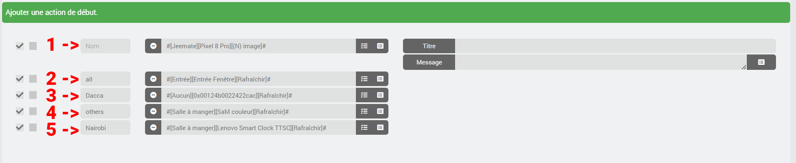
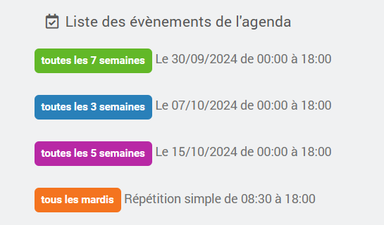
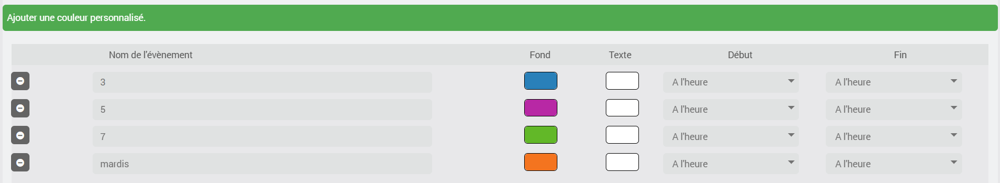
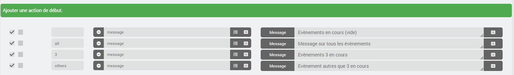
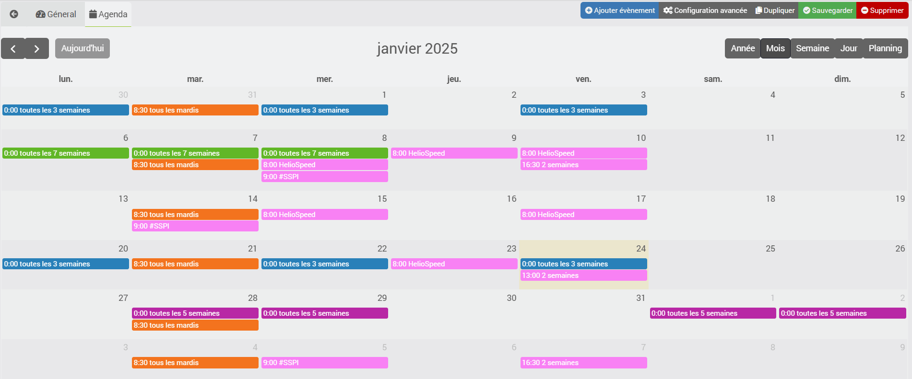

# import2calendar plugin

This plugin is used to import a calendar in ICal format into the official Jeedom Calendar plugin; therefore, the latter must be installed and configured.
## Prerequisites
### Stable
- Jeedom 4.4 or later, Debian 11 or later
- Agenda plugin, installed and activated
- import2calendar plugin

### Beta
- Jeedom 4.6 or later, Debian 12 or later
- Agenda plugin, installed and activated
- import2calendar plugin

## Warning
**No changes can be made to the iCal file; the information is retrieved from the iCal file and sent to the Jeedom Calendar plugin. Do not make any changes to the calendar created in the Calendar plugin, as they will be deleted the next time your iCal file is updated.**

# <u>Configuration</u>

## Plugin Configuration
- **Number of days for past event retention**: the length of time a past event remains in the calendar, ranging from 3 to 31 days (default is 3).
- **Upcoming Commands**: Adds commands for the coming days (see the Agenda Plugin section) to all calendars in the Agenda Plugin, including those not created by import2calendar.

## Create a device
Start by adding a device and choosing a name for it
### Import settings
- **ical**: Specify the URL of the ical file to be converted.
- **Forced start times**: Select a start time for all events in the calendar. By default, these will be the start times of the events saved in the iCal file.
- **Forced end times**: Select an end time for all events in the calendar. By default, these will be the end times of the events saved in the iCal file.
- **General iCal**: French school breaks and holidays. If selected, leave the iCal field blank.
- **Auto-refresh**: Select the desired refresh schedule for the calendar.

### Display Settings
- **icon**: the icon that will be applied to each event.
- **Background color**: Default background color for each event.
- **text color**: default text color for each event.

### Customizing Events
Here you can choose to customize certain events in your iCal.

- Background color and text color.

By default, nothing is changed here; these options allow you to modify the start and end times so that, for example, you can schedule actions in advance.
- Start: The event will begin X minutes before its start time (from 0 to 360).
- End: The event will end X minutes after its end time (from 0 to 360).

### Start and End Actions
The actions defined here will be added to all events on your calendar.
You can rearrange actions using drag-and-drop.

In the **name** field, you can specify the event for which the action is intended.
- Accepts a partial name
- Ignores capital letters

**1** and **2** - Leave blank or enter **all** to have the action added to all calendar events.
**4** - Select **others** so that the action is added to all calendar events except those for which a custom action is scheduled.
**3** and **5** - Enter the **event name** so that the action is added only for those events.

You can now click **Save**.
The corresponding calendar entry will be created in the calendar plugin.

Example:

Here, we can see the events in the Calendar plugin; we can also see that I’ve customized the color as well.

Configuration in the import2calendar plugin

Let's go back to the calendar to check the actions

## Editing a device
If you change any of the following options:
- icon
- background color
- text color
- event customization (colors, start and end times)
- Fixed start and end times
- Actions de début
- final actions

Events will be updated in the calendar as soon as the device is saved.

## Event Management
The iCal is processed every time the device is saved and every time its **Refresh** command is executed. The defined cron job, on the other hand, only processes it if the iCal has changed.
On the first day of each month, as well as after each plugin update, all schedules are reprocessed the next time their cron job runs. A device without a cron job is processed only at its next backup.
If an event is no longer in the iCal file, it is removed from the calendar.
Events that occurred more than 3 days ago (this duration can be adjusted in the plugin settings) are not imported and will be deleted over time.

## Instances
The rules defined in your iCal file are converted to the Jeedom Agenda format. I haven't tested all the possibilities, so if any of them don't work, please include the line from the import2calendar log: **START OPTIONS** (set your logs to debug mode).

Events in the occurrence remain visible on the calendar as long as the occurrence is valid.

Example: 1 event every 5 days from March 1, 2024, to November 24, 2024. All events are visible on the calendar until November 27, 2024 (3 days after the end of the occurrence, using the default duration).

## Calendar Plugin
Commands with information about upcoming events will be added to your calendar. They are updated every night, or on demand using the **Update J+** button on the plugin page.
You will therefore have 9 new commands:
- yesterday
- today
- tomorrow
- the day after tomorrow
- Day 3
- Day 4
- Day 5
- Day 6
- Day 7

## ical <-> Jeedom
Some recurring events are not supported in the Calendar plugin, for example:
- Tuesdays and Wednesdays every 3 weeks

These are then imported as dates, calculated on an annual basis and recalculated each time the calendar is processed, no later than the 1st of each month. A device without a cron job must therefore be backed up at least once a year to ensure these dates do not expire.

# <u>JeeMate</u>
- The description and location will be visible in the calendar imported into JeeMate.

# <u>Warning</u>
- The name of the created schedule is the same as that of the device plus "-ical" (it can be renamed later)
- The room will be identical

# <u>Support</u>
- Jeedom Community
- Discord JeeMate

# <u>Request for Help</u>
To make it easier for me to debug a conversion error, I'd like to ask you to create a test calendar with only the event that's causing the problem and to give me access to that iCal.

# <u>Acknowledgments</u>
The plugin and support are free, but if you'd like to buy me a coffee or some diapers, I thank you in advance.

