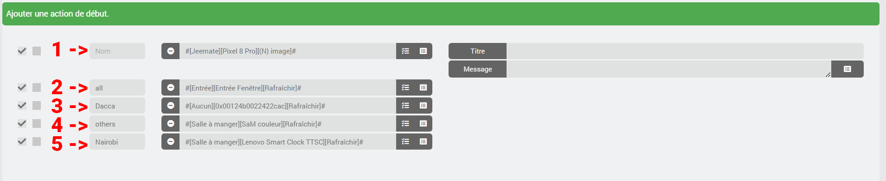
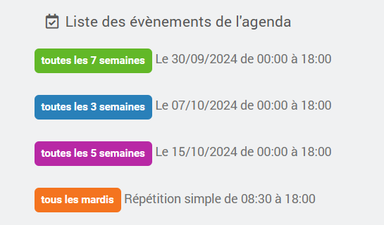
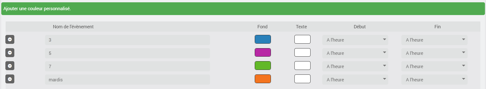
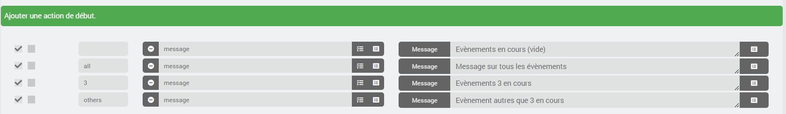
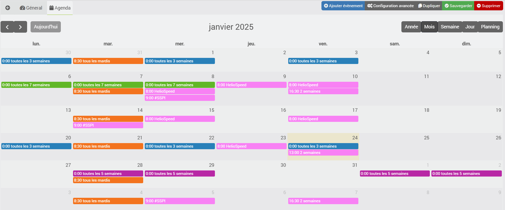

# Complemento import2calendar

El complemento sirve para importar un calendario en formato iCal al complemento oficial de Jeedom «Agenda» (calendar), por lo que este último debe estar instalado y configurado.
## Requisitos previos
- Jeedom 4.4 como mínimo, Debian 11 como mínimo
- Complemento Agenda, instalado y activado
- Complemento import2calendar

## Atención
**No es posible realizar modificaciones en el archivo iCal; se recogen los datos del iCal para enviarlos al complemento «Agenda» de Jeedom. No realices ninguna modificación en la agenda creada en el complemento «Agenda», ya que se eliminarían con la próxima actualización de tu iCal.**

# <u>Configuración</u>

## Configuración del complemento
- **Número de días de retención**: periodo durante el cual un evento pasado permanece en la agenda, de 3 a 31 días (3 por defecto).
- **comandos de los próximos días**: añade los comandos de los próximos días (véase la sección «Plugin Agenda») a todas las agendas del plugin Agenda, incluidas aquellas que no hayan sido creadas por import2calendar.

## Crear un dispositivo
Empieza por añadir un dispositivo y elige su nombre
### Parámetros de importación
- **ical**: indica la URL del archivo ical que se va a convertir.
- **Horas de inicio obligatorias**: elegir una hora de inicio para todos los eventos del calendario. Por defecto, se utilizarán las horas de inicio del evento guardado en el iCal.
- **Horas de finalización obligatorias**: elegir una hora de finalización para todos los eventos del calendario. Por defecto, serán las horas de finalización del evento guardado en el iCal.
- **ICAL general**: vacaciones escolares francesas y días festivos. Si se selecciona esta opción, no hay que indicar nada en el campo ical.
- **Actualización automática**: elige la frecuencia de actualización deseada para el calendario.

### Ajustes de visualización
- **icono**: el icono que se aplicará a cada evento.
- **color de fondo**: color de fondo predeterminado para cada evento.
- **color del texto**: color predeterminado del texto para cada evento.

### Personalización de eventos
Aquí puedes personalizar algunos eventos de tu calendario iCal.

- Color de fondo y color del texto.

Aquí, por defecto, no se ha modificado nada; estas opciones permiten cambiar la hora de inicio y de finalización para, por ejemplo, anticipar las acciones programadas.
- Inicio: el evento comenzará X minutos antes de la hora de inicio (de 0 a 360).
- Fin: el evento finalizará X minutos después de su hora de finalización (de 0 a 360).

### Acciones de inicio y fin
A todos los eventos de tu calendario se les añadirán las acciones definidas aquí.
Puedes reorganizar las acciones arrastrándolas y soltándolas.

En el campo **nombre**, puedes indicar el evento para el que está prevista la acción.
- Acepta un nombre parcial
- No tiene en cuenta las mayúsculas

**1** y **2**: déjalos en blanco o escribe **all** para que la acción se añada a todos los eventos de la agenda.
**4** - Selecciona **otros** para que la acción se añada a todos los eventos de la agenda, excepto a aquellos para los que se haya previsto una acción personalizada.
**3** y **5**: introduce el **nombre del evento** para que la acción solo se añada a ellos.

Ahora puedes hacer clic en **guardar**.
La agenda correspondiente se creará en el complemento de agenda.

Ejemplo:

Aquí vemos los eventos del complemento Agenda; además, se puede observar que también he personalizado el color.

La configuración en el complemento import2calendar

Volvemos a la agenda para comprobar las acciones

## Edición de un dispositivo
Si modificas alguna de las siguientes opciones:
- icono
- color de fondo
- color del texto
- personalización de eventos (colores, inicio y fin)
- horas de inicio y fin fijas
- primeros pasos
- acciones finales

Los eventos se modificarán en el calendario en cuanto se guarde el dispositivo.

## Gestión de eventos
El iCal se procesa cada vez que se guarda el equipo y cada vez que se ejecuta su comando **Actualizar**. Por su parte, el cron definido solo lo procesa si el iCal ha cambiado.
El primer día de cada mes, así como tras cada actualización del complemento, todas las agendas se procesan de nuevo en la siguiente ejecución de su cron. Un dispositivo sin cron solo se procesa en su próxima copia de seguridad.
Si un evento ya no aparece en el archivo iCal, se elimina del calendario.
Los eventos que hayan tenido lugar hace más de 3 días (duración ajustable en la configuración del complemento) no se importan y se irán eliminando progresivamente.

## Ocurrencias
Las reglas definidas en tu ical se convierten al formato de Jeedom Agenda. No he probado todas las posibilidades; si alguna no funciona, por favor, adjunta la línea del registro de import2calendar: **START OPTIONS** (activa el modo de depuración en tus registros).

Los eventos incluidos en la ocurrencia siguen siendo visibles en el calendario mientras la ocurrencia sea válida.

Ejemplo: 1 evento cada 5 días desde el 1 de marzo de 2024 hasta el 24 de noviembre de 2024. Todos los eventos se pueden ver en el calendario hasta el 27 de noviembre de 2024 (3 días después de que finalice la ocurrencia, con la duración predeterminada).

## Complemento Agenda
En tu agenda se añadirán las notificaciones sobre los próximos eventos. Se actualizan cada noche o, si lo deseas, pulsando el botón **Actualización J+** de la página del complemento.
Así pues, dispondrás de 9 nuevos comandos:
- ayer
- hoy
- mañana
- pasado mañana
- día 3
- día 4
- día 5
- día 6
- d+7

## ical <-> Jeedom
Hay algunas recurrencias que no existen en el complemento Agenda, por ejemplo:
- los martes y miércoles cada tres semanas

A continuación, se importan en forma de fechas, se calculan para un año y se vuelven a calcular cada vez que se procesa la agenda, a más tardar el día 1 de cada mes. Por lo tanto, un dispositivo sin cron debe guardarse al menos una vez al año para que estas fechas no caduquen.

# <u>JeeMate</u>
- La descripción y la ubicación aparecerán en el calendario importado a JeeMate.

# <u>Atención</u>
- El nombre de la agenda creada es el mismo que el del dispositivo + «-ical» (posteriormente se puede cambiar el nombre).
- la habitación será idéntica

# <u>Asistencia técnica</u>
- Comunidad Jeedom
- Discord JeeMate

# <u>Solicitud de ayuda</u>
Para facilitarme la tarea a la hora de depurar un error de conversión, os pediría que creaseis un calendario de pruebas que incluya únicamente el evento que plantea el problema y que me dierais acceso a ese ICAL.

# <u>Agradecimientos</u>
El complemento y la asistencia técnica son gratuitos, pero si queréis invitarme a un café o regalarme pañales para bebés, os lo agradezco de antemano.

