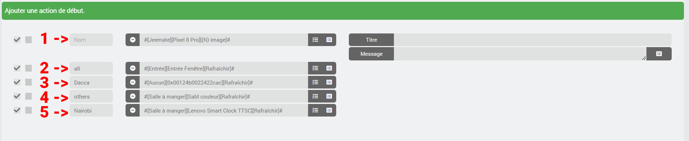
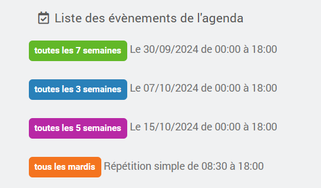
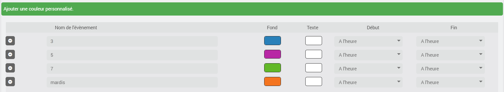
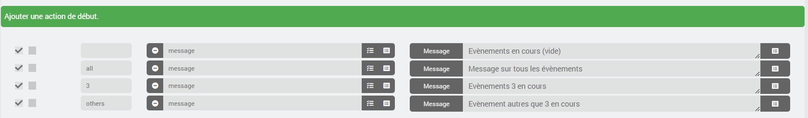
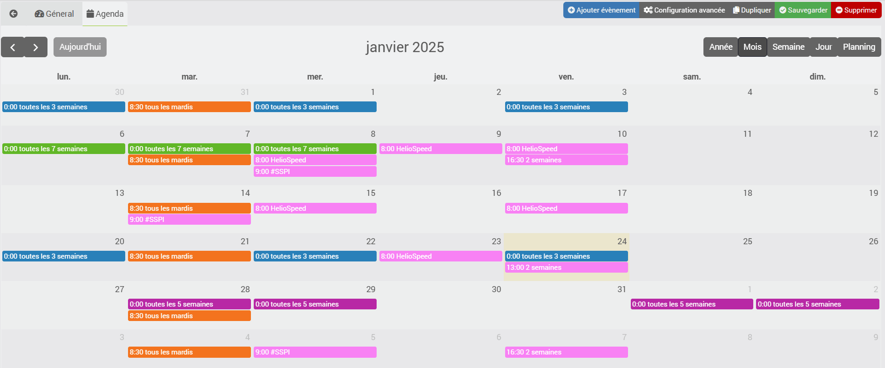

# Plugin import2calendar

Il plugin serve a importare un calendario in formato iCal nel plugin Agenda ufficiale di Jeedom (calendar); quest'ultimo deve quindi essere installato e configurato.
## Requisiti
### Stabile
- Jeedom 4.4 o versioni successive, Debian 11 o versioni successive
- Plugin Agenda, installato e attivato
- Plugin import2calendar

### Beta
- Jeedom 4.6 o versioni successive, Debian 12 o versioni successive
- Plugin Agenda, installato e attivato
- Plugin import2calendar

## Attenzione
**Non è possibile apportare modifiche al file iCal: le informazioni vengono recuperate dal file iCal per essere inviate al plugin Agenda di Jeedom. Non apportate alcuna modifica all'agenda creata nel plugin Agenda, poiché verrebbero eliminate al prossimo aggiornamento del vostro file iCal.**

# <u>Configurazione</u>

## Configurazione del plugin
- **Numero di giorni di conservazione**: periodo durante il quale un evento passato rimane nell'agenda, da 3 a 31 giorni (3 per impostazione predefinita).
- **ordini dei giorni successivi**: aggiunge gli ordini dei giorni a venire (vedi la sezione Plugin Agenda) a tutti i calendari del plugin Agenda, compresi quelli che non sono stati creati da import2calendar.

## Crea un dispositivo
Inizia aggiungendo un dispositivo e scegliendone il nome
### Impostazioni di importazione
- **ical**: specificare l'URL del file ical da convertire.
- **Nome utente** e **Password**: da inserire solo se il server dell'agenda richiede l'autenticazione (ad esempio Baïkal, con un URL del tipo `http://serveur/dav.php/calendars/utilisateur/default?export`). Lasciare vuoti per Google, Outlook e gli indirizzi pubblici.
  - Non inserite la password nell'URL: in questi campi viene crittografata e non viene mai più visualizzata.
  - Lascia vuoto il campo **Password** per mantenere quella registrata. Cancella il campo **Nome utente** per eliminarlo.
  - Sono accettate le autenticazioni Digest e, solo su HTTPS, Basic. Il certificato di un indirizzo HTTPS deve essere valido.
  - Specificare l'indirizzo finale del calendario: i reindirizzamenti non vengono seguiti quando viene specificato un identificativo.
- **Orari di inizio predefiniti**: scegli un orario di inizio per tutti gli eventi del calendario. Per impostazione predefinita, saranno gli orari di inizio dell'evento salvato nel file iCal.
- **Orari di fine forzati**: scegliere un orario di fine per tutti gli eventi del calendario. Per impostazione predefinita, saranno gli orari di fine dell'evento registrati nel file iCal.
- **ICAL generale**: vacanze scolastiche francesi e giorni festivi. Se selezionato, non inserire nulla nel campo ical.
- **Aggiornamento automatico**: selezionare il cron di aggiornamento desiderato per il calendario.

### Impostazioni di visualizzazione
- **icona**: l'icona che verrà applicata a ogni evento.
- **colore di sfondo**: colore di sfondo predefinito per ogni evento.
- **colore del testo**: colore predefinito del testo per ogni evento.

### Personalizzazione degli eventi
Qui puoi scegliere di personalizzare alcuni eventi del tuo calendario iCal.

- Colore dello sfondo e colore del testo.

Qui, per impostazione predefinita, non viene modificato nulla; queste opzioni consentono di modificare l'ora di inizio e di fine, ad esempio per anticipare le azioni programmate.
- Inizio: l'evento inizierà X minuti prima dell'ora di inizio (da 0 a 360).
- Fine: l'evento terminerà X minuti dopo l'ora di fine (da 0 a 360).

### Azioni di inizio e fine
A tutti gli eventi del tuo calendario verranno aggiunte le azioni definite qui.
È possibile riorganizzare le azioni tramite trascinamento.

Nel campo **nome** è possibile indicare l'evento per il quale è prevista l'azione.
- Accetta un nome parziale
- Non tiene conto delle maiuscole

**1** e **2** - Lasciare vuoto o inserire **all** affinché l'azione venga aggiunta a tutti gli eventi dell'agenda.
**4** - Selezionare **altri** affinché l'azione venga aggiunta a tutti gli eventi dell'agenda, tranne quelli per i quali è prevista un'azione personalizzata.
**3** e **5** - Inserire il **nome dell'evento** affinché l'azione venga aggiunta solo per questi.

Ora puoi cliccare su **Salva**.
L'agenda corrispondente verrà creata nel plugin agenda.

Esempio:

Qui vediamo gli eventi nel plugin Agenda; si nota inoltre che ho personalizzato anche il colore.

Configurazione nel plugin import2calendar

Torniamo all'agenda per verificare le azioni

## Modifica di un dispositivo
Se si modifica una delle seguenti opzioni:
- icona
- colore di sfondo
- colore del testo
- personalizzazione degli eventi (colori, inizio e fine)
- orari di inizio e fine fissi
- azioni iniziali
- azioni di chiusura

Gli eventi verranno modificati nel calendario non appena l'apparecchio verrà salvato.

## Gestione degli eventi
L'ical viene elaborato ogni volta che si salva la configurazione dell'apparecchiatura e ogni volta che si esegue il comando **Aggiorna**. Il cron definito, invece, lo elabora solo se l'ical è cambiato.
Il primo giorno di ogni mese, nonché dopo ogni aggiornamento del plugin, tutte le agende vengono rielaborate al successivo passaggio del loro cron. Un dispositivo privo di cron viene rielaborato solo al successivo salvataggio.
Se un evento non è più presente nel file iCal, viene eliminato dal calendario.
Gli eventi risalenti a più di 3 giorni fa (durata regolabile nelle impostazioni del plugin) non vengono importati e verranno eliminati man mano.

## Occorrenze
Le regole definite nel vostro ical vengono convertite nel formato Jeedom Agenda. Non ho testato tutte le possibilità; se alcune non dovessero funzionare, vi prego di allegare la riga del log di import2calendar: **START OPTIONS** (impostate i vostri log in modalità debug).

Gli eventi presenti nell'occorrenza rimangono visibili sul calendario finché l'occorrenza è valida.

Esempio: 1 evento ogni 5 giorni dal 01-03-2024 al 24-11-2024. Tutti gli eventi sono visibili sul calendario fino al 27-11-2024 (3 giorni dopo la fine dell'evento, con la durata predefinita).

## Plugin Agenda
Nel vostro calendario verranno aggiunte le informazioni relative agli eventi in programma. Queste vengono aggiornate ogni notte oppure su richiesta tramite il pulsante **Aggiornamento J+** nella pagina del plugin.
Avrete quindi 9 nuovi comandi:
- ieri
- oggi
- domani
- dopodomani
- giorno 3
- giorno 4
- giorno 5
- giorno 6
- giorno 7

## ical <-> Jeedom
Alcune ricorrenze non sono disponibili nel plugin Agenda, ad esempio:
- martedì e mercoledì ogni tre settimane

Vengono quindi importate sotto forma di date, calcolate su base annuale e ricalcolate ad ogni elaborazione dell'agenda, al più tardi il primo giorno di ogni mese. Un dispositivo privo di cron deve quindi essere salvato almeno una volta all'anno affinché queste date non scadano.

# <u>JeeMate</u>
- la descrizione e il luogo saranno visibili nel calendario importato in JeeMate.

# <u>Attenzione</u>
- il nome dell'agenda creata è lo stesso di quello del dispositivo + "-ical" (può poi essere rinominata)
- la stanza sarà identica

# <u>Assistenza</u>
- Comunità Jeedom
- Discord JeeMate

# <u>Richiesta di assistenza</u>
Per semplificarmi il lavoro durante il debug di un errore di conversione, vi chiedo di creare un calendario di prova contenente solo l'evento che presenta il problema e di fornirmi l'accesso a questo file iCal.

# <u>Ringraziamenti</u>
Il plugin e l'assistenza sono gratuiti, ma se volete offrirmi un caffè o dei pannolini per bambini, vi ringrazio in anticipo.

