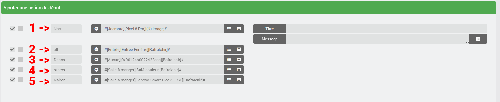
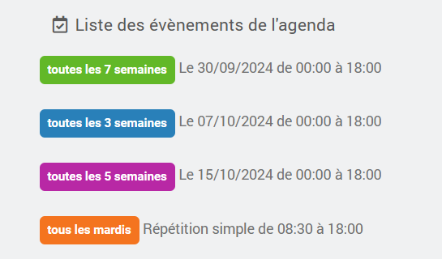
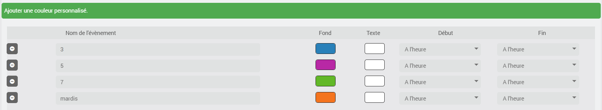
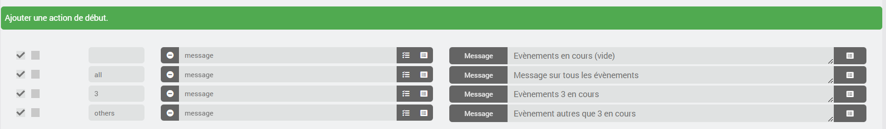
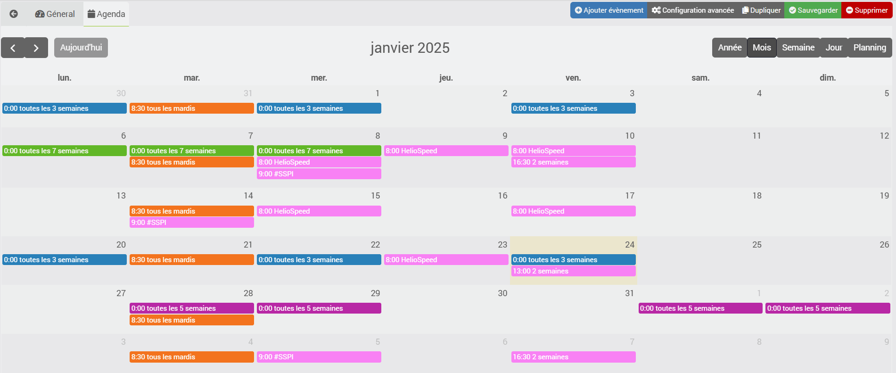

# Plugin import2calendar

O plugin serve para importar um calendário no formato iCal para o plugin Agenda oficial do Jeedom (calendar), pelo que este último deve estar instalado e configurado.
## Requisitos prévios
- Jeedom 4.4 ou superior, Debian 11 ou superior
- Plugin Agenda, instalado e ativado
- Plugin import2calendar

## Atenção
**Não é possível efetuar quaisquer alterações no ficheiro iCal; as informações são recolhidas do ficheiro iCal para serem enviadas para o plugin Agenda do Jeedom. Não efetue quaisquer alterações na agenda criada no plugin Agenda, pois estas serão eliminadas na próxima atualização do seu ficheiro iCal.**

# <u>Configuração</u>

## Configuração do plugin
- **Número de dias de retenção**: período durante o qual um evento passado permanece na agenda, de 3 a 31 dias (3 por predefinição).
- **comendas dos próximos dias**: adiciona as recomendas dos próximos dias (ver a secção Plugin Agenda) a todas as agendas do plugin Agenda, incluindo aquelas que não foram criadas pelo import2calendar.

## Criar um equipamento
Comece por adicionar um dispositivo e escolha o seu nome
### Parâmetro de importação
- **ical**: indicar o URL do ficheiro ical a converter.
- **Horários de início fixos**: selecionar um horário de início para todos os eventos do calendário. Por predefinição, serão utilizados os horários de início do evento registados no iCal.
- **Horários de fim obrigatórios**: selecionar um horário de fim para todos os eventos do calendário. Por predefinição, serão os horários de fim do evento registado no iCal.
- **ICAL geral**: férias escolares francesas e feriados. Se esta opção for selecionada, não indique nada no campo ical.
- **Atualização automática**: selecione a frequência de atualização pretendida para o calendário.

### Parâmetros de visualização
- **ícone**: o ícone que será aplicado a cada evento.
- **cor de fundo**: cor de fundo predefinida para cada evento.
- **cor do texto**: cor do texto predefinida para cada evento.

### Personalização de eventos
Aqui pode optar por personalizar determinados eventos do seu ical.

- Cor do fundo e cor do texto.

Por predefinição, nada é alterado; estas opções permitem alterar a hora de início e de fim para, por exemplo, antecipar as ações programadas.
- Início: o evento terá início X minutos antes da hora marcada (de 0 a 360).
- Fim: o evento terminará X minutos após a hora de fim (de 0 a 360).

### Ações de início e de fim
A todas as ocasiões do seu calendário serão adicionadas as ações aqui definidas.
Pode reorganizar as ações arrastando e largando.

Pode indicar na caixa **nome** o evento para o qual a ação está prevista.
- Aceita um nome parcial
- Não tem em conta as maiúsculas

**1** e **2** - Deixe em branco ou introduza **all** para que a ação seja adicionada a todos os eventos da agenda.
**4** - Selecione **outros** para que a ação seja adicionada a todos os eventos da agenda, exceto aqueles para os quais está prevista uma ação personalizada.
**3** e **5** - Indique o **nome do evento** para que a ação seja adicionada apenas para esses eventos.

Agora pode clicar em **guardar**.
A agenda correspondente será criada no plugin de agenda.

Exemplo:

Aqui, vemos os eventos no plugin Agenda; além disso, podemos ver que também personalizei a cor.

A configuração no plugin import2calendar

Voltemos à agenda para verificar as ações

## Edição de um equipamento
Se alterar uma das seguintes opções:
- ícone
- cor de fundo
- cor do texto
- personalização de eventos (cores, início e fim)
- horários de início e fim obrigatórios
- ações iniciais
- ações finais

Os eventos serão alterados no calendário assim que o equipamento for guardado.

## Gestão de eventos
O iCal é processado sempre que o equipamento é guardado e sempre que é executado o comando **Atualizar**. O cron definido, por sua vez, só o processa se o iCal tiver sido alterado.
No primeiro dia de cada mês, bem como após cada atualização do plugin, todas as agendas são processadas novamente na próxima execução do seu cron. Um equipamento sem cron só é processado na sua próxima gravação.
Se um evento já não estiver no iCal, é eliminado da agenda.
Os eventos ocorridos há mais de 3 dias (duração ajustável na configuração do plugin) não são importados e serão eliminados progressivamente.

## Ocorrências
As regras definidas no seu ical são convertidas para o formato Jeedom Agenda. Não testei todas as possibilidades; caso algumas não funcionem, por favor, anexe a linha do registo do import2calendar: **START OPTIONS** (coloque os seus registos em modo de depuração).

Os eventos presentes na ocorrência permanecem visíveis no calendário enquanto a ocorrência for válida.

Exemplo: 1 evento a cada 5 dias, de 01-03-2024 a 24-11-2024. Todos os eventos ficam visíveis no calendário até 27-11-2024 (3 dias após o fim da ocorrência, com a duração predefinida).

## Plugin Agenda
Na sua agenda, serão adicionadas informações sobre os próximos eventos. Estas são atualizadas todas as noites ou, a pedido, através do botão **Atualização J+** na página do plugin.
Terá, portanto, 9 novos comandos:
- ontem
- hoje
- amanhã
- depois de amanhã
- j+3
- dia 4
- j+5
- dia 6
- j+7

## ical <-> Jeedom
Algumas recorrências não existem no plugin Agenda, por exemplo:
- terça e quarta-feira, a cada três semanas

Essas datas são então importadas, calculadas com base num ano e recalculadas sempre que a agenda é processada, o mais tardar no dia 1 de cada mês. Um equipamento sem cron deve, portanto, ser guardado pelo menos uma vez por ano para que essas datas não se esgotem.

# <u>JeeMate</u>
- a descrição e o local ficarão visíveis na agenda importada para o JeeMate.

# <u>Atenção</u>
- o nome da agenda criada é igual ao do equipamento + «-ical» (pode ser renomeado posteriormente)
- a divisão será idêntica

# <u>Suporte</u>
- Comunidade Jeedom
- Discord JeeMate

# <u>Pedido de ajuda</u>
Para facilitar o meu trabalho na depuração de um erro de conversão, peço-vos que criem um calendário de teste com apenas o evento que está a causar problemas e que me concedam acesso a esse ficheiro iCal.

# <u>Agradecimentos</u>
O plugin e o suporte são gratuitos; no entanto, se quiserem oferecer-me um café ou fraldas para bebé, agradeço desde já.

